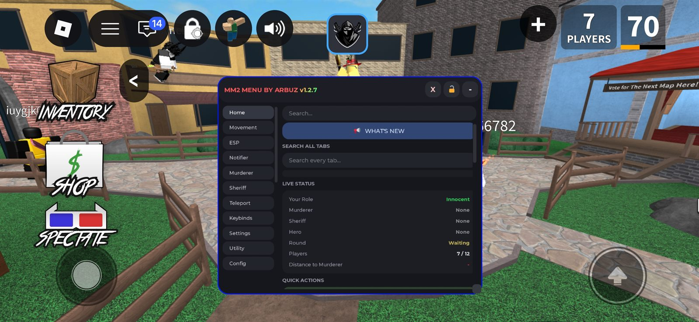
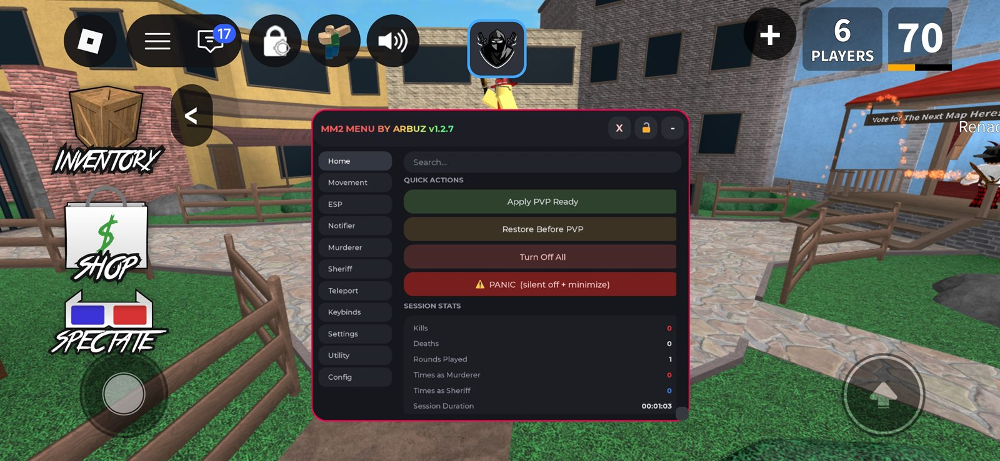
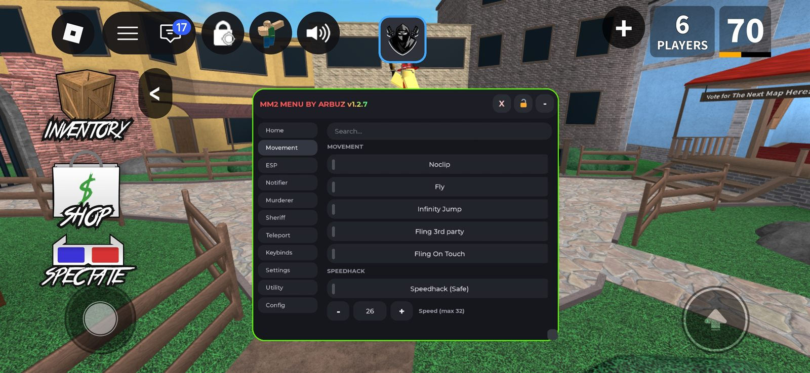
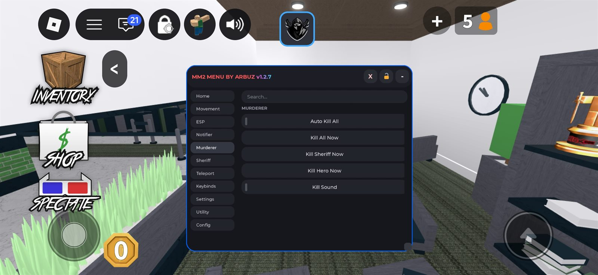
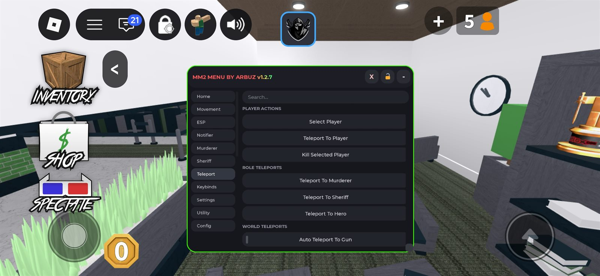

<div align="center">

# 🎮 MM2 MENU BY ARBUZ

**A single-file Roblox Lua menu for Murder Mystery 2 — built for Delta Executor.**

[](https://github.com/arbuz181pl/MM2-MENU-BY-ARBUZ)
[](https://luau-lang.org)
[](https://www.roblox.com/games/278822489)
[-8b5cf6?style=flat-square)](https://delta-executor.github.io)
[](#)
[](#-safety-notes)

**Made:** 17/09/2026 · **Updated:** 17/10/2026 · **Version:** `v1.2.7` · **Author:** [arbuz181pl](https://github.com/arbuz181pl)

</div>

---

## 📋 Overview

**MM2 Menu by Arbuz** is a complete in-game GUI for **Murder Mystery 2**, injected into `PlayerGui` through your executor. Everything — role ESP, movement, teleports, alerts, keybinds, presets — lives in **one `Lua` file** with **zero dependencies** and **zero manual setup**.

Paste the loadstring, run it, and a draggable, resizable, rainbow-titled menu appears in the top-left corner.

> 🎯 **Who it's for:** players who want role information, quality-of-life movement, and round alerts without leaving the game — on **PC and mobile**.

---

## 📸 Screenshots

All shots are unedited gameplay — menu border colour matches the active tab (green / blue / red). Click any image for full size.

<table>
  <tr>
    <td align="center" width="33%"><a href="docs/home-status.jpg"></a><br><sub><b>Home</b> · Live Status</sub></td>
    <td align="center" width="33%"><a href="docs/home-quick-actions.jpg"></a><br><sub><b>Home</b> · Quick Actions & Stats</sub></td>
    <td align="center" width="33%"><a href="docs/movement.jpg"></a><br><sub><b>Movement</b> · Speedhack 26</sub></td>
  </tr>
  <tr>
    <td align="center" width="33%"><a href="docs/murderer.jpg"></a><br><sub><b>Murderer</b> · Kill controls</sub></td>
    <td align="center" width="33%"><a href="docs/teleport.jpg"></a><br><sub><b>Teleport</b> · Role & world</sub></td>
    <td align="center" width="33%"><a href="docs/utility.jpg"></a><br><sub><b>Utility</b> · Overlays & Trails</sub></td>
  </tr>
</table>

---

## 🚀 Quick start

Open your executor, paste this into the Lua script editor and hit **Execute**.

```lua
loadstring(game:HttpGet("https://raw.githubusercontent.com/arbuz181pl/MM2-MENU-BY-ARBUZ/refs/heads/main/MM2MENU.lua"))()
```

**Requirements**

| Requirement | Detail |
|---|---|
| Executor | **Delta Executor** (tested) — other Luau executors may work |
| Game | Murder Mystery 2 on Roblox |
| Script output | Needs `loadstring`, `game:HttpGet`, `setclipboard` (copy-loadstring button) |
| Mobile | Supported — the UI auto-scales to touch devices |

**Controls**

- **Close** the menu with the `X` button (asks for confirmation first).
- **Reopen** it with the floating circular **MM2** button that appears on the left.
- **Drag** the header to move, **drag the bottom-right corner** to resize, **🔓** to lock the position.

> [!TIP]
> There's a **Copy Loadstring** button in `Home → SCRIPT INFO` — it puts the loadstring on your clipboard so you can paste it into your executor later.

---

## ✨ Features

The menu is organised into **11 tabs**. Use `Home → SEARCH ALL TABS` to jump straight to any toggle by name.

### 🏠 Home

Dashboard and one-click control of everything else.

- **Live Status card** — your role, Murderer, Sheriff, Hero, round state, player count, and live distance to the Murderer
- **Search all tabs** — type to find any toggle across every tab and click the result to jump there
- **Quick Actions**
  - `Apply PVP Ready` — one click turns on the full combat preset (see below)
  - `Restore Before PVP` — reverts every setting back to before PVP Ready
  - `Turn Off All` — disables every toggle safely
  - `⚠ PANIC` — silently kills all toggles *and* minimises the menu, no sound
- **Session Stats** — kills, deaths, rounds played, times as Murderer / Sheriff, session duration
- **Script Info** — version, place ID, job ID, and server region
- **Notification History** — every alert you received this session, click any line to copy it

> [!IMPORTANT]
> **PVP Ready** turns ON: Anti AFK, Anti Void, Anti Fling, all 4 role ESPs, Gun ESP, Noclip, Auto Kill All, Killer Alarm (30 studs), Gun Drop Alert, and the Rainbow Crosshair on PC.
> It deliberately leaves **Speedhack, Fly and Fling off** — those are the ones most likely to get you removed.

### 🚀 Movement

| Feature | What it does |
|---|---|
| **Noclip** | Disables `CanCollide` on every `BasePart` and restores the exact original values when toggled off |
| **Fly** | Opens a separate, draggable fly panel with speed control — hold **Shift** to double the speed |
| **Infinity Jump** | Jump as high as you like by re-applying upward velocity |
| **Fling 3rd party** | Classic fling that launches other players |
| **Fling On Touch** | Integrated fling that triggers on touch input (re-added in v1.2.7) |
| **Speedhack (Safe)** | Adjustable from **1–32** (default **26**), straight-line path, survives round end and respawn |

- Speedhack **pauses automatically while Fly is on** and restores itself afterwards
- Fling toggles **auto-disable Anti Fling** (they conflict) and restore it afterwards

### 👀 ESP

- **Role ESP** — separate highlights for **Innocent**, **Murderer**, **Sheriff** and **Hero**, each with its own colour
- **Item ESP** — highlights the dropped **Gun** in purple wherever it falls
- **Self Rainbow ESP** — a cycling rainbow highlight on your own character, so you always know where you are in a crowd
- **Player Distance** — a billboard above every player showing live distance in **studs**
- All ESP is applied via `Highlight` instances and cleaned up the moment you toggle it off

### 🔔 Notifier

Everything that tells you *what is happening*, without looking away from the game.

- **Notify Roles** — one-shot notification with the Murderer / Sheriff / Hero names
- **Auto Notify Round** — announces roles automatically each round
- **Re-announce Every 30s** — repeats the role callout on a timer until the round ends
- **Notify When Hero Changes** — catches Hero swaps mid-round
- **Round Start / Round End** alerts
- **Player Join / Leave** alerts
- **Auto-hide UI in round** — automatically hides the menu when a round starts

**Chat Announcements**

- Send **Murderer** or **Sheriff** in the public chat manually
- Or enable **Auto Send** to post it for you the moment the role is known
- Uses the modern `TextChatService` API with a `SetCore` fallback for older clients

### 🔪 Murderer

- **Kill All Now** — instantly kill every living player outside of spawn
- **Kill Sheriff Now** / **Kill Hero Now** — targeted one-taps
- **Auto Kill All** — keeps doing it automatically while you're the Murderer
- **Kill Sound** — plays an audio cue on every kill
- Players standing in **spawn are skipped**, so you don't waste swings on safekeepers

> [!WARNING]
> **Kill Murderer** (Sheriff tab) is marked **WIP and temporarily disabled** — it doesn't work reliably yet.

### 🎯 Sheriff

- **Kill Murderer Now (WIP)** — *disabled in this version*, kept visible so you know it's coming
- Your gun, knife and role state are read from the game itself, so it works with the real Sheriff kit

### 🌀 Teleport

**Player actions** — pick any player from a searchable dropdown and teleport to them, or kill them.

**Role teleports**

- Teleport To **Murderer**
- Teleport To **Sheriff**
- Teleport To **Hero**

**World teleports**

- Teleport To **Gun** — grabs the dropped gun and returns you to where you were
- **Auto Teleport To Gun** — does it automatically whenever you're unarmed, with a 3s cooldown and a smart safe-position check so you don't land next to the Murderer
- Teleport To **Spawn**

### ⌨ Keybinds

- Master switch — **All Keybinds Enabled** disables every hotkey instantly
- **12 rebindable actions** — click a key button and press any key, **ESC** cancels
- Active keybinds are mirrored live on the Home tab

<details>
<summary><b>Default keybinds</b></summary>

| Key | Action |
|---|---|
| `Left Alt` | Toggle Fly |
| `N` | Toggle Noclip |
| `Q` | Toggle Speedhack |
| `J` | Toggle Infinity Jump |
| `K` | Toggle Auto Kill All |
| `G` | Toggle Gun ESP |
| `M` | Toggle Murderer ESP |
| `H` | Toggle Sheriff ESP |
| `I` | Toggle Innocent ESP |
| `B` | Toggle Anti Void |
| `Y` | Turn Off All |
| `End` | Panic (silent off + minimise) |

</details>

### 🎚 Settings

| Setting | Range | Notes |
|---|---|---|
| **Menu Opacity** | 10–100% | Slides to fully see through the menu in crowded fights |
| **Menu Sound Volume** | 0–100% | Scales every UI click and notification |
| **Kill Sound Volume** | 0–100% | Separate mixer channel for the kill cue |

### 🛠 Utility

- **Anti Fall Down (Void)** — rescues you below `Y = -50` and returns you to your last safe position
- **Anti Fling** — heartbeat protection against fling attacks, with safer linear/angular speed thresholds; refuses to enable while a Fling toggle is on
- **Anti AFK** — uses `VirtualUser` to keep your session alive
- **Gun Drop Alert** — tells you the moment the gun hits the floor

**Overlays**

- **Killer Alarm** — audible alert when the Murderer gets within 30 studs, firing only when they're *closer* than the last alert (plus a cooldown so it doesn't spam)
- **Camera Follow Murderer** — locks your camera onto the Murderer
- **Rainbow Crosshair** — follows your mouse and hides the system cursor (PC only, and the menu knows it)

**Trails** — attach a coloured trail to the **Killer**, **Sheriff** or **Hero** so you can follow them through walls of players.

**Server** — **Rejoin Server** through `TeleportService`.

### 💾 Config

- **Enable / Disable All Notifications** — flip every alert in one press
- **3 named config slots** — type a name, hit **Save**, then **Load** to apply the whole preset instantly
- **PRESET INFO** panel documenting exactly what PVP Ready does and does not include

---

## 🧠 How it works

```
loadstring(game:HttpGet(...))
  └── MM2MENU.lua  (single file, no modules)
       │
       ├── ScreenGui "MM2Menu"  →  PlayerGui
       │     ├── Header  · title gradient · close / lock / minimise
       │     ├── Tab rail  · 11 tabs
       │     ├── ScrollingFrame  →  tabFrames[tab]  · layout-ordered sections
       │     ├── Reopen button  (floating circle, shown after minimise)
       │     └── Fly panel  (separate draggable frame)
       │
       ├── State  S  ── one flat table, one source of truth
       │     └── every toggle reads and writes here, then refreshes its own UI
       │
       └── Game readers
             ├── GetPlayerData  →  roles (Murderer / Sheriff / Hero)
             ├── Players + Characters  →  ESP, distance, teleports, kills
             ├── UserInputService  →  keybinds, rebinding, mouse crosshair
             └── RunService.Heartbeat  →  flight, speedhack, anti-fling, anti-void
```

**Design decisions worth knowing**

- **Single file on purpose.** No `require`, no asset ids, no installer — one `HttpGet` and it runs, which is exactly what an executor loadstring wants.
- **One flat state table (`S`).** Snapshots, presets and config slots are just tables of booleans copied out of `S` and replayed back through the same `setOn` / `setOff` helpers, so a toggle can never drift out of sync with its button.
- **UI is built from code, not assets.** Every `Frame`, `TextButton`, `UICorner` and `UIGradient` is instanced at runtime, so the script ships **no images**. The only asset references are four built-in Roblox `rbxasset://` sound ids for notifications and alerts.
- **Mobile is detected, not guessed.** `IS_MOBILE` scales every size by `0.68` through a single `mn()` helper, and disables PC-only features like the crosshair instead of showing a dead button.
- **Layout order is centralised.** `getLayoutOrder()` hands out monotonic indices so sections, toggles and info rows stack predictably in a `UIListLayout` — no manual re-ordering when you add a feature.
- **Role reads are cached and debounced.** `ROLE_NOTIFY_DELAY` (2.5s) and `ROUND_END_DEBOUNCE` (2s) stop duplicate alerts during the noisy frames right after a round flips.
- **Cleanup is explicit.** Highlights, trails and connection objects are tracked and destroyed on toggle-off, so nothing is left rendering behind your back.

---

## 🗂 Project layout

```
MM2-MENU-BY-ARBUZ/
├── MM2MENU.lua      # the entire menu — ~4,500 lines
├── docs/            # screenshots used by this README
└── README.md
```

Within the file, sections are clearly banner-marked so you can jump straight to what you want:

```
-- WHAT'S NEW MODAL        -- CLOSE CONFIRMATION MODAL
-- HOME TAB                -- MOVEMENT TAB         -- ESP TAB
-- NOTIFIER TAB            -- MURDERER TAB         -- SHERIFF TAB
-- TELEPORT TAB            -- KEYBINDS TAB         -- SETTINGS TAB
-- UTILITY TAB             -- CROSSHAIR            -- CONFIG TAB
-- ESP SYSTEM
```

---

## 🛡️ Safety notes

> [!IMPORTANT]
> **No detection reports** have come in for this script as of `v1.2.7`. That is a report count, not a guarantee — nothing client-side can promise immunity.

> [!WARNING]
> **`!speedhack`, `!fly` and `!noclip` may get you kicked.** They are not patched yet, and they change movement in ways the game's server can see. Use them at your own risk and expect moderation.

**Known rough edges**

| Area | Status |
|---|---|
| Speedhack / Fly / Noclip | Unpatched — possible kicks |
| Server Hop | **Removed** — was unreliable |
| Kill Murderer (Sheriff tab) | **WIP**, disabled |
| Auto Fling detection | Uncertain — not verified in every server |
| Config slots | In-memory only — cleared when the script reloads |

> [!TIP]
> **Bug reports are welcome.** Open an issue with your **executor**, your **device**, and the **exact toggle** that misbehaved — that trio is what makes a report fixable.

---

## 📜 Changelog

### `v1.2.7` — 16/10/2026

- Fling On Touch re-added
- Anti Fling pauses for fling toggles and restores afterwards
- Anti Fling heartbeat reworked with safer thresholds
- Speedhack no longer freezes you while jumping
- Speedhack cap raised to **32** (safe max), default **26**
- Speedhack now survives round end and respawn
- Speedhack path is now straight (no curving on turns)
- Speedhack pauses while Fly is on, and restores when Fly is off
- Gun Drop Alert & Killer Alarm included in **PVP Ready**
- Fling toggles auto-disable Anti Fling
- Crosshair now follows the mouse and hides the default cursor
- Fly speed doubles while **Shift** is held
- Added **Self Rainbow ESP**
- Removed **Server Hop** (unreliable)
- **Kill Murderer** temporarily disabled (WIP)

> The script ships an in-game **📢 WHAT'S NEW** modal with this same list, so you always see it without leaving the game.

---

## 👤 Credits

- **[Roblox](https://www.roblox.com)** and the **Murder Mystery 2** team — the game this runs in
- **[Delta Executor](https://delta-executor.github.io)** — the tested executor
- **Everyone who reported a bug** — 46 commits of fixes started with your messages

---

<div align="center">

**Found a bug?** [Open an issue](https://github.com/arbuz181pl/MM2-MENU-BY-ARBUZ/issues) · **Like it?** ⭐ Star it

Made with ☕ by [arbuz181pl](https://github.com/arbuz181pl)

</div>